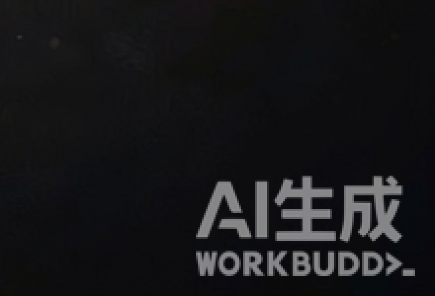
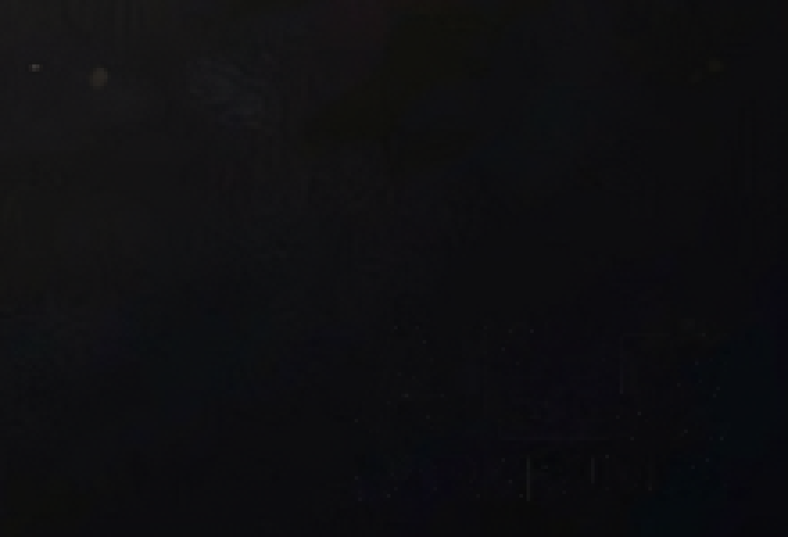

# WorkBuddy 去水印

擦除 **WorkBuddy / ImageGen 生成图右下角固定的「AI生成 WORKBUDDY」角标**。

不是涂抹，不是模糊，是**已知 alpha 反混合**：预先从纯色底图反解出水印每个像素的透明度，再对目标图逐像素反算，把水印"揭掉"，底下的真实画面自然回来。

画布尺寸不变 ｜ 零第三方依赖 ｜ 单张约 2.4 秒 ｜ 原图不动

<p align="center">
  
  
  <br>
  <sub>左：处理前（右下角角标）　右：处理后（4 倍放大，无残留）</sub>
</p>

---

## 为什么不用通用的去水印方案

涂抹、模糊、AI 修复都会在画面上留下补丁感，尤其是在暗部纹理上。

而这个水印有个特点：**位置、尺寸、透明度永远固定**——111×51 像素，距右/底各 10 像素，不随图片尺寸缩放。既然它每次都长得一模一样，就可以把它的透明度精确算出来，然后做数学反算：

```
原图 = (带水印图 − 白色 × α) / (1 − α)
```

算得准，就等于"从来没盖过"。

实测三种尺寸（1024×1024、1536×1024、1024×1536），水印全部是同一尺寸同一位置，所以**一份蒙版通吃所有图**。

---

## 安装

### 方式一：直接放技能目录（推荐）

```bash
git clone https://github.com/Gitxiaozi/workbuddy-watermark-remover.git \
  ~/.workbuddy/skills/workbuddy-watermark-remover
```

重开会话，输入"去水印"即可触发。

### 方式二：用 zip 包

下载 [`dist/workbuddy-watermark-remover.zip`](dist/workbuddy-watermark-remover.zip)，解压到 `~/.workbuddy/skills/` 下，确保结构是：

```
~/.workbuddy/skills/workbuddy-watermark-remover/SKILL.md
```

### 方式三：不用技能，直接跑脚本

```bash
python scripts/clean_image.py 图片.png
```

只需要 Python 3.8+，无任何第三方依赖。

---

## 用法

```bash
# 单张（默认 auto：优先擦除，不成就改裁切）
python scripts/clean_image.py 图片.png

# 强制擦除，画布尺寸不变
python scripts/clean_image.py 图片.png --mode erase

# 强制裁掉底部水印条
python scripts/clean_image.py 图片.png --mode crop

# 整个目录批量
python scripts/clean_image.py 某目录/

# 低置信度也强制处理
python scripts/clean_image.py 图片.png --force
```

输出：擦除为 `原名_clean.png`，裁切为 `原名_cropped.png`。**原图一律不动。**

### 参数

| 参数 | 说明 |
|------|------|
| `--mode auto` | 默认。置信度足够就擦除，否则降级裁切 |
| `--mode erase` | 反混合擦除，画布尺寸不变 |
| `--mode crop` | 切掉底部含水印的横条（默认再多切 8px） |
| `--safety N` | crop 模式的额外余量，默认 8 |
| `--force` | 置信度低于阈值也照样处理 |

### 怎么判断有没有成功

脚本会打印**置信度**：

- `> 6` 正常，擦除完成
- `3 ~ 6` 痕迹偏弱，auto 会降级裁切
- `< 3` 视为未检出，自动跳过

实测真水印通常 36 ~ 120，无水印图约 −0.1 ~ 0.5，区分度很高。

想肉眼核对，可以放大右下角看看：

```python
import sys; sys.path.insert(0, 'scripts')
from clean_image import zoom
zoom('结果_clean.png', 宽-240, 高-160, 240, 160, 4, '核对图.png')
```

---

## 适用边界

**只对右下角固定位置的平台角标有效。**

| 情况 | 能不能处理 |
|------|-----------|
| WorkBuddy / ImageGen 右下角「AI生成」角标 | ✅ 完美，无残留 |
| 公众号、第三方账号自己叠的白色文字 | ❌ 位置不固定，蒙版对不上 |
| 水印在画面中间或位置不固定 | ❌ 同上 |
| 非 PNG 格式（JPG/WebP） | ⚠️ 需先转 PNG |

遇到不支持的情况，能做的只有裁掉（`--mode crop`）或补背景，后者必然有痕迹。

判断口诀：**位置固定 → 反混合（完美）；位置不固定 → 只能裁或补。**

---

## 平台换水印了怎么办

如果模型平台改了角标样式（字号、位置、加了图案），旧蒙版会立刻失效，表现为置信度掉到 0 附近。此时重建蒙版即可，不用改代码：

1. 生成两张纯色/极简背景图，提示词例如：
   `Flat neutral gray studio gradient background only, completely empty, minimal, no subject, no text.`
2. 重建：

```bash
python scripts/rebuild_mask.py 灰底图1.png 灰底图2.png
```

会覆盖 `assets/wm_alpha_ref.png`，并打印 alpha 峰值（正常约 0.55）与非零占比（正常约 24%）。

3. 拿张旧图复测，置信度回到 30 以上就算成功。

---

## 文件结构

```
workbuddy-watermark-remover/
├── SKILL.md                      # 技能定义与触发词
├── assets/
│   └── wm_alpha_ref.png          # 144×84 水印透明度蒙版（锚定右下角）
├── scripts/
│   ├── clean_image.py            # 主入口：擦除 / 裁切 / 批量 / 放大核对
│   ├── crop_png.py               # 纯标准库 PNG 读写（五种行过滤器）
│   ├── analyze_wm.py             # 从纯底图反解 alpha
│   ├── rebuild_mask.py           # 用两张纯底图重建蒙版
│   └── locate_wm.py              # 自动定位水印框（诊断用）
└── dist/
    └── workbuddy-watermark-remover.zip
```

---

## 已知限制

- 仅支持 PNG（8bit、非隔行）。JPG/WebP 需先转 PNG。
- 假设水印为纯白叠加；若实际为浅灰，擦除会略偏暗。
- `locate_wm.py` 只在纯色底图上可靠，复杂画面会被高光干扰，生产流程用固定锚点 + 相关度打分。
- 图片宽或高小于 148px 时拒绝处理。

---

## 合规说明

仅用于**本地整理与私用文件**。

对外发布 AI 生成内容时，请遵守《人工智能生成合成内容标识办法》等相关规定，不得以去除标识的方式冒充人工创作。请勿对无权修改的第三方作品去水印。

---

## English

Removes the fixed **"AI-generated / WORKBUDDY"** badge that WorkBuddy stamps in the bottom-right corner of generated images.

The badge is always identical — 111×51 px, 10 px from the right and bottom edges, never scaled. So instead of inpainting, this tool recovers the per-pixel alpha from a plain-color reference image and inverts the blend:

```
original = (watermarked − white × α) / (1 − α)
```

This leaves no patch, no blur, and no change to canvas size.

```bash
python scripts/clean_image.py image.png            # auto
python scripts/clean_image.py image.png --mode erase
python scripts/clean_image.py /path/to/folder/     # batch
```

Pure Python standard library — no Pillow, no OpenCV, no numpy.

Only works on fixed-position platform badges. Watermarks placed by third-party accounts (WeChat pages, blogs, etc.) are out of scope.

---

## License

[MIT](LICENSE)
